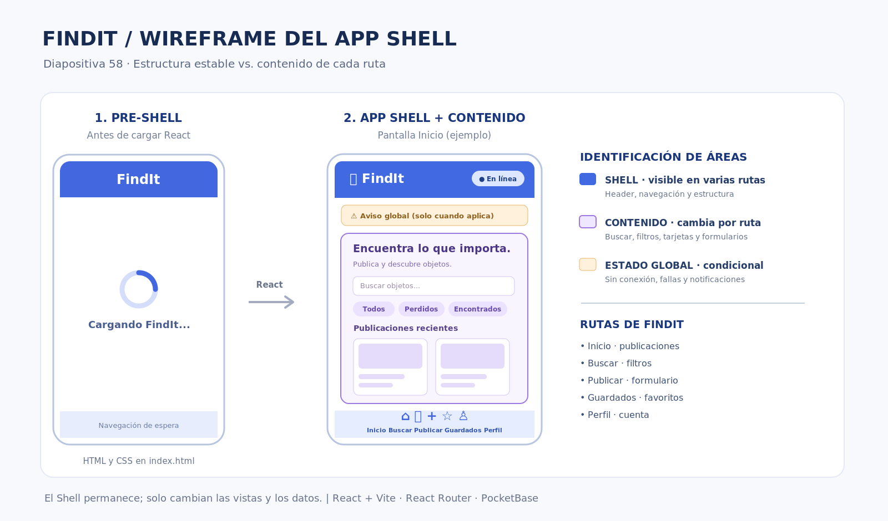

# FindIt — Objetos perdidos y encontrados

## Descripción del proyecto

FindIt es una aplicación web progresiva (PWA) desarrollada para facilitar la publicación y búsqueda de objetos perdidos y encontrados dentro de una comunidad.

La aplicación permite consultar publicaciones, buscar objetos, aplicar filtros y guardar favoritos. Su diseño está adaptado para celulares y computadoras.

## Tecnologías utilizadas

- React y Vite
- React Router
- CSS y Lucide React
- vite-plugin-pwa y Workbox
- Firebase Hosting
- GitHub Actions

## Funcionalidades

- Inicio de sesión de demostración.
- Publicación de objetos perdidos y encontrados.
- Búsqueda por nombre, categoría y lugar.
- Filtros por tipo, fecha, categoría y ubicación.
- Consulta de detalles de publicaciones.
- Favoritos y administración de publicaciones.
- Detección del estado de conexión.
- Instalación como aplicación PWA.
- Carga de recursos esenciales sin conexión.

Los datos de las publicaciones se guardan actualmente mediante localStorage en cada navegador. Todavía no existe una base de datos compartida ni autenticación real.

## Tabla de definición del App Shell

| Área | Elemento de FindIt | Implementación | Sin conexión | Semana |
|---|---|---|---|---|
| Pre-shell | Pantalla inicial con logo FindIt y animación | index.html | Puede mostrarse desde caché | 1 |
| Encabezado | Marca FindIt, título e indicador de conexión | Frame en FindItApp.jsx | Permanece visible e indica falta de conexión | 1 |
| Navegación | Inicio, Buscar, Publicar, Guardados y Perfil | Frame / bottom-nav | Permite acceder a vistas disponibles | 1 |
| Contenido (rutas) | Publicaciones, búsqueda, formularios y detalles | React Router / Routes | Muestra publicaciones guardadas localmente | 1 |
| Indicador de red | Estados En línea y Sin conexión | Frame / online | Muestra el aviso de desconexión | 1 |
| Estados de carga | Skeletons animados y carga de pantallas | ItemsSkeleton / Suspense | Conserva la información disponible | 1 |
| Errores y 404 | Recuperación de errores y página no encontrada | ViewErrorBoundary.jsx / NoEncontrado.jsx | Evita que una falla deje la pantalla en blanco | 1 |
| Feedback global | Alertas de API y notificaciones de acciones | api-alert / findit-toast | Muestra advertencias y confirmaciones locales | 1 |
| Acción global | Acceso rápido para publicar objetos | Frame / Publicar.jsx | Permite crear publicaciones locales | 1 |

## Wireframe

El diseño principal de FindIt está organizado en tres áreas:

**Encabezado:** marca FindIt, nombre de la sección y estado de conexión.

**Contenido central:** buscador, filtros, tarjetas de objetos, formularios y detalles de publicaciones.

**Navegación inferior:** Inicio, Buscar, Publicar, Guardados y Perfil.

El encabezado y la navegación se mantienen mientras cambia el contenido de las secciones.

## Pruebas realizadas

- Compilación correcta con npm run build.
- Revisión del código con npm run lint.
- Funcionamiento de las rutas y formularios.
- Generación del manifiesto PWA.
- Registro y activación del Service Worker.
- Prueba básica de funcionamiento sin conexión.
- Despliegue de vista previa mediante GitHub Actions.

## Ejecutar el proyecto

1. Instalar las dependencias: `npm install`
2. Iniciar el servidor local: `npm run dev`
3. Compilar la aplicación: `npm run build`
4. Probar la versión compilada: `npm run preview`

## Trabajo colaborativo

Los integrantes trabajan mediante ramas independientes en GitHub. Cada cambio se propone utilizando un Pull Request, que activa GitHub Actions para generar una vista previa en Firebase.

Al integrar los cambios en la rama main, se actualiza automáticamente la versión pública.

## Enlaces

Repositorio: https://github.com/CarlosResendezHDZ/mi-librero

Aplicación pública: https://mi-librero-85180.web.app

## Próximas mejoras

Se planea integrar una base de datos compartida, autenticación real y mejoras en la sincronización de información entre usuarios.